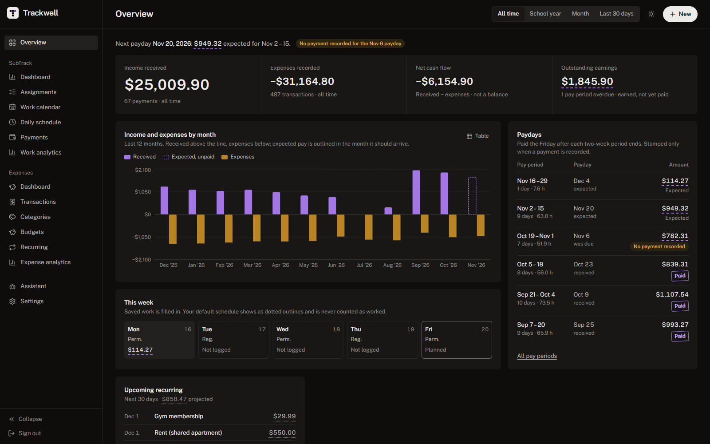
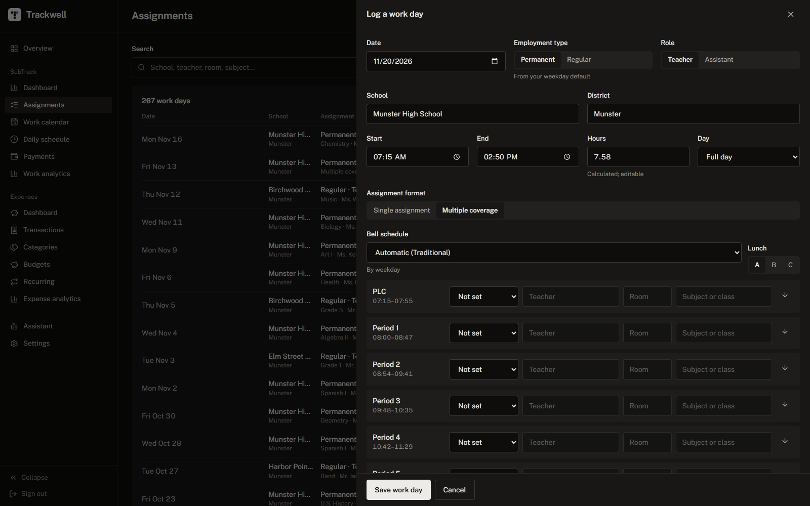
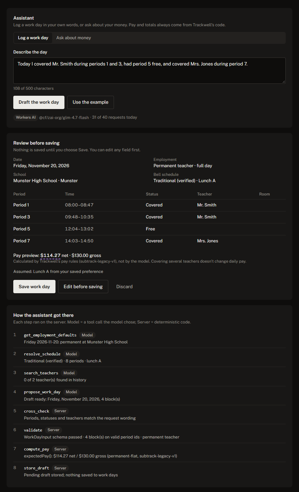

<p align="center">
  <picture>
    <source media="(prefers-color-scheme: dark)" srcset="brand/logo-horizontal-dark.svg">
    
  </picture>
</p>
<p align="center"><b>Work. Earn. Understand.</b></p>

Trackwell is a personal ledger for substitute teachers. It records each school day down to the class period, works out the expected pay with deterministic rules, matches it against the payments that actually arrive, and tracks personal expenses and budgets alongside. An AI assistant can turn a sentence like *"I covered Mr. Smith in periods 1 and 3 and Mrs. Jones in period 7"* into a validated draft, which you review and confirm before anything is saved.

It replaces two earlier single-purpose apps (a work/pay tracker and an expense tracker) and carries their history across with a verified, reversible migration.

> All screenshots and sample data in this repository are synthetic.

## Screenshots

| Overview | Multiple coverage | AI assignment entry |
|---|---|---|
|  |  |  |

## Features

- **Unified financial overview.** Money received, money expected but not yet paid, projected work and money spent are always kept apart. Net cash flow is never presented as a bank balance.
- **Assignment management.** Permanent and regular substitute days, teacher and instructional-assistant roles, and full or half days. Search and filters across every work day.
- **Multiple-teacher coverage.** One paid day can cover several teachers, period by period. Pay is counted once per day, never per teacher.
- **Bell schedules.** Schedules are stored as data (weekday rules, per-date overrides, lunch variants, split periods). The bundled school schedule was transcribed from the official published image and is checked row by row in tests.
- **Payroll tracking.** 14-day pay periods with expected paydays, reconciliation of expected against received pay, manual payday overrides, and outstanding pay.
- **Class and teacher autocomplete.** Suggestions come from your own saved work, are case-insensitive and de-duplicated, and a teacher's own classes come first.
- **Expense management.** Transactions, categories, payment methods, recurring plans (generated idempotently on the server), monthly and default budgets.
- **Budgets and analytics.** Monthly trends, category breakdowns, budget against actual, and work analytics by school year and school. Every chart has a table view.
- **AI-powered assignment entry.** A server-side tool-calling agent on Cloudflare Workers AI, described below.
- **Persistent context.** Weekday employment defaults and assistant preferences are stored in the database and applied to every new entry and assistant request.
- **Secure data storage.** Single-owner authentication, record-level writes with optimistic concurrency, soft deletes and an audit log.

## Architecture

```
Browser (React SPA)
   │  HTTPS · session cookie + CSRF header
   ▼
Cloudflare Worker ──── static assets (dist/) with CSP, HSTS and security headers
   ├── auth: PBKDF2 password, D1 sessions, rate limiting
   ├── /api/v1: Zod-validated record-level API (snapshot read + per-record writes)
   ├── assistant: tool loop → pending draft → explicit confirm → verified save
   │       └── Workers AI binding (@cf/zai-org/glm-4.7-flash)
   └── D1 (SQLite): work days, coverage, payments, expenses, settings, drafts, audit
```

| Layer | Technology |
|---|---|
| Frontend | React 19, TypeScript, Vite, Tailwind CSS v4, React Router, Recharts |
| Domain logic | Pure TypeScript in `src/domain`: pay engine, pay periods, schedules, expenses, earnings model |
| API contract | Zod schemas shared by the browser and the Worker (`src/shared`) |
| Backend | Cloudflare Workers |
| Database | Cloudflare D1, with versioned SQL migrations in `migrations/` |
| AI | Cloudflare Workers AI (no API keys; Worker binding) |
| Tests | Vitest (unit and integration on SQLite with the real migrations), Playwright + axe (end-to-end and accessibility) |

## Getting started

Requirements: Node.js 22.6 or newer, and Chrome or Edge for the browser tests.

```bash
npm install
npm run dev:setup          # random dev-only password in .dev.password; applies migrations to the local D1
npm run db:seed:synthetic  # optional: synthetic demo records
npm run build              # once: the Worker serves dist/ for non-API routes
npm run dev:api            # terminal 1: Worker + local D1 on http://127.0.0.1:8787
npm run dev                # terminal 2: app on http://127.0.0.1:5173
```

Sign in with the password in `.dev.password`. In development builds, `?data=empty|one|worst-case|loading|error` previews interface states with synthetic data.

### Configuration

| Setting | Where | Purpose |
|---|---|---|
| `ADMIN_PASSWORD_HASH` | `.dev.vars` locally (see `.dev.vars.example`); Worker **secret** in production | PBKDF2 hash of the single owner's password. Generate with `node tools/hash-password.mjs`. |
| `ALLOWED_ORIGIN` | `wrangler.toml` `[vars]` | The exact origin allowed to make state-changing requests |
| `AI_MODE` | `wrangler.toml` `[vars]` | `mock` (local default, rule-based and labelled in the UI), `workers-ai`, or `off`. `workers-ai` without a binding answers 503; it never falls back to the mock. |
| `AI_MODEL` | `wrangler.toml` `[vars]` | Workers AI model id |
| `AI_DAILY_LIMIT` | `wrangler.toml` `[vars]` | Assistant requests per day |

### Database

Migrations live in `migrations/` and are applied with Wrangler:

```bash
npm run db:migrate:local                                                  # local D1
npx wrangler d1 migrations apply <database> --remote --env production    # a deployment you own
```

To deploy your own copy:
1. Create a D1 database (`npx wrangler d1 create <name>`) and put its id and your domain in `wrangler.toml` under `[env.production]`.
2. Set the secret with `node tools/hash-password.mjs | npx wrangler secret put ADMIN_PASSWORD_HASH --env production`.
3. Run `npm run build && npx wrangler deploy --env production`.

## AI assignment entry

The assistant runs entirely in the Worker. The model can **propose**; only the server **decides**, and only you **save**.

1. The model calls four tools in order: `get_employment_defaults`, `resolve_schedule`, `search_teachers`, `propose_work_day`.
2. The server resolves the date and period ids. It validates the draft with the same schema the API uses, cross-checks it against the wording of the request (omitted, duplicated or misassigned periods are sent back to the model), and computes pay with the deterministic engine.
3. The result is a **pending draft** with a visible tool trace. You can edit it in the normal editor.
4. Saving goes through a separate confirm endpoint. It claims the draft atomically, so a second confirm saves nothing, then reads the record back to verify it.

Money questions ("How much did I spend last month?") send **only the question** to the model; the totals come from parameterized SQL and a fixed template. Prompts are versioned files (`worker/src/ai/prompts/`). An evaluation set (`worker/src/ai/eval/cases.ts`) runs offline with the mock model and against real Workers AI with `npm run ai:eval`. Details are in [docs/assistant.md](docs/assistant.md).

## Testing

```bash
npm run check       # strict typecheck · eslint · prettier · vitest (unit + API integration on SQLite)
npm run build
npm run test:e2e    # Playwright on the real Worker + a fresh synthetic local D1, including axe accessibility scans
npm run ai:eval     # assistant evaluation set against a running Worker (see docs/assistant.md)
```

The original pay calculation code is kept byte-for-byte in `src/domain/legacy/` as a test oracle. The engine must match it on every input.

## Security and privacy

- **Authentication.** Single-owner password login: PBKDF2-SHA256, server-side sessions stored only as hashes, `__Host-` HttpOnly SameSite=Strict cookies, CSRF protection (origin check plus a per-session header) and login rate limiting.
- **Writes.** Every write is validated, parameterized, version-checked and audited. Deletes are soft. No endpoint replaces the whole dataset.
- **Transport and headers.** Production is HTTPS-only (HTTP redirects, HSTS), with a strict CSP pinned to the one inline script by hash, `frame-ancestors 'none'` and nosniff.
- **AI.** No API keys exist; the model can't save, never computes money, and only reads through fixed queries. Requests are length-limited, step-limited, time-limited and capped per day.
- **Data.** Real financial data is never part of this repository. Tests, screenshots and demo datasets are synthetic.

More: [docs/security.md](docs/security.md) · [docs/decisions.md](docs/decisions.md) · [docs/migration-runbook.md](docs/migration-runbook.md)

## Project layout

```
src/app/        React UI (shell, pages, charts, form primitives)
src/domain/     pure domain logic and its tests; legacy/ is the byte-identical oracle
src/shared/     API contract shared by browser and Worker
worker/src/     Worker: auth, API, assistant (ai/), entry and security headers
migrations/     D1 schema
tools/          dev setup, password hashing, synthetic seed, migration tooling, AI test runners
e2e/            Playwright tests and screenshot scripts
docs/           architecture decisions, security, assistant, migration runbook
brand/          editable SVG logo sources (Period Grid): icon, wordmark, monochrome, app icons
```

## Status

In production use by its owner since November 2026. It is a personal project built around one teacher's school (bell schedule, pay rules), so adapting it to another district means editing the schedule data and pay-rule constants.

## License

Copyright © Trackwell. All rights reserved. The source is published for reference only; no license is granted to use, copy, modify or distribute it.
